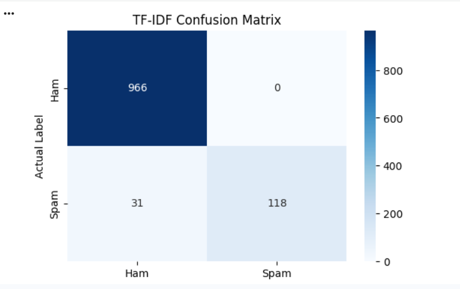

# Email Spam Detection Using Natural Language Processing (NLP)

## Project Overview

This project focuses on developing a Machine Learning-based Email Spam Detection system using Natural Language Processing (NLP).

The objective is to classify email messages into two categories:

- **Ham:** Legitimate emails.
- **Spam:** Unwanted, fraudulent, or promotional emails.

The project explores different text representation techniques to understand their impact on machine learning classification performance.

The following NLP techniques are implemented and compared:

1. Bag of Words (BoW)
2. Term Frequency–Inverse Document Frequency (TF-IDF)
3. Word2Vec

## Technologies Used

- **Programming Language:** Python
- **Data Processing:** Pandas, NumPy
- **Natural Language Processing:** NLTK
- **Machine Learning:** Scikit-learn
- **Word Embeddings:** Gensim
- **Data Visualization:** Matplotlib, Seaborn
- **Development Environment:** Google Colab / Jupyter Notebook

## NLP Techniques Implemented

### 1. Bag of Words (BoW)

Bag of Words converts email text into numerical feature vectors based on word occurrence.

**Implementation:**
- Text representation using `CountVectorizer`.
- Feature extraction using bigrams.
- Maximum of 2,500 features.
- Binary feature representation.
- Classification using Multinomial Naive Bayes.

### 2. TF-IDF (Term Frequency–Inverse Document Frequency)

TF-IDF represents email text based on the importance of words within an email relative to the complete collection of emails.

**Implementation:**
- Text representation using `TfidfVectorizer`.
- Unigram and bigram feature extraction.
- Maximum of 2,500 features.
- Classification using Multinomial Naive Bayes.

### 3. Word2Vec

Word2Vec is a word embedding technique that converts words into dense numerical vectors to capture semantic relationships.

**Implementation:**
- Word embedding generation using Gensim.
- Training a Word2Vec model on the training email messages.
- Skip-gram architecture (`sg=1`).
- Vector size of 100 dimensions.
- Average word embeddings to generate document-level representations.
- Classification using Logistic Regression.

## Project Workflow

The project follows these major steps:

1. Load the email spam dataset.
2. Examine the dataset and class distribution.
3. Clean and preprocess email messages.
4. Convert text to lowercase.
5. Remove unwanted characters and stopwords.
6. Apply stemming using Porter Stemmer.
7. Split the dataset into training and testing sets.
8. Apply Bag of Words, TF-IDF, and Word2Vec techniques.
9. Train the respective machine learning classifiers.
10. Evaluate model performance using classification metrics.
11. Compare the results and visualize model performance.

## Dataset

**Dataset:** Email Spam Dataset

The dataset contains email messages labelled as either `ham` or `spam`.

The dataset is used to train and evaluate machine learning models for identifying unwanted email messages.

## Model Evaluation

The models are evaluated using the following performance metrics:

- **Accuracy:** Measures the overall proportion of correctly classified emails.
- **Precision:** Measures how many emails predicted as spam are actually spam.
- **Recall:** Measures how many actual spam emails are correctly identified.
- **F1-Score:** Represents the harmonic mean of precision and recall.
- **Confusion Matrix:** Provides a detailed view of correct and incorrect predictions.

### Model Performance Comparison

The following table presents the performance of the three implemented NLP approaches on the test dataset.

| Model | Classification Algorithm | Accuracy | Precision | Recall | F1-Score |
|---|---|---:|---:|---:|---:|
| Bag of Words | Multinomial Naive Bayes | 96.68% | 99.12% | 75.84% | 85.93% |
| TF-IDF | Multinomial Naive Bayes | 97.22% | 100.00% | 79.19% | 88.39% |
| Word2Vec | Logistic Regression | 96.50% | 89.86% | 83.22% | 86.41% |

### Key Observations

- **TF-IDF achieved the highest accuracy of 97.22%** and the highest F1-score of 88.39%.
- **TF-IDF achieved 100% precision**, indicating that all emails predicted as spam in the test set were actually spam.
- **Word2Vec achieved the highest recall of 83.22%**, identifying a larger proportion of actual spam emails compared with the other two approaches.
- Bag of Words achieved an accuracy of 96.68%, demonstrating strong classification performance.

### Model Evaluation Visualizations

#### 1. TF-IDF Confusion Matrix

The confusion matrix illustrates the classification performance of the TF-IDF model on the test dataset.

#### 2. Word2Vec Classification Report

The classification report presents the precision, recall, F1
